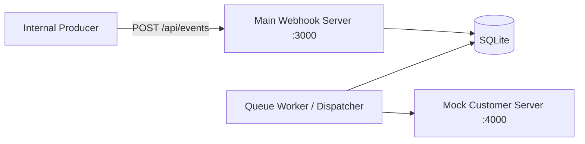

# Reliable Webhook Delivery Service

## One-line run command

From the project directory, install dependencies and start everything in one terminal:

```bash
npm install && npm start
```

This command idempotently initializes `webhooks.db`, seeds the five customer scenarios, starts the Mock Customer Server on port `4000`, starts the queue worker, and starts the REST API on port `3000`.

The seeded customers are:

| Customer | Mock behavior |
| --- | --- |
| `cust_healthy` | Always returns HTTP 200 |
| `cust_slow` | Responds after 6 seconds and exercises timeout/retry |
| `cust_failing_500` | Always returns HTTP 500 |
| `cust_fatal_404` | Always returns HTTP 404 |
| `cust_flaky` | Returns HTTP 503 twice, then HTTP 200 |

Run `npm run db:init` at any time to initialize/seed again safely. Existing customer subscriptions are updated rather than duplicated.

## One-line automated test command

```bash
npm test
```

This runs the complete hermetic delivery test suite from start to finish and prints the result in the terminal.

## Copy-paste API examples

Send an event to each scenario (each command prints an `event.id` in the response):

```bash
curl -sS -X POST http://localhost:3000/api/events -H 'Content-Type: application/json' -d '{"customerId":"cust_healthy","eventType":"order.created","payload":{"orderId":"ORD-healthy"}}'
curl -sS -X POST http://localhost:3000/api/events -H 'Content-Type: application/json' -d '{"customerId":"cust_slow","eventType":"order.created","payload":{"orderId":"ORD-slow"}}'
curl -sS -X POST http://localhost:3000/api/events -H 'Content-Type: application/json' -d '{"customerId":"cust_failing_500","eventType":"order.created","payload":{"orderId":"ORD-500"}}'
curl -sS -X POST http://localhost:3000/api/events -H 'Content-Type: application/json' -d '{"customerId":"cust_fatal_404","eventType":"order.created","payload":{"orderId":"ORD-404"}}'
curl -sS -X POST http://localhost:3000/api/events -H 'Content-Type: application/json' -d '{"customerId":"cust_flaky","eventType":"order.created","payload":{"orderId":"ORD-flaky"}}'
```

Check an event by replacing `evt_ID_FROM_POST_RESPONSE` with the returned ID:

```bash
curl -sS http://localhost:3000/api/events/evt_ID_FROM_POST_RESPONSE
```

Other useful commands:

```bash
curl -sS http://localhost:3000/api/health
curl -sS http://localhost:4000/webhook/received
curl -sS -X POST http://localhost:4000/webhook/reset
```

## Architecture



- `src/server.ts` launches the API, queue worker, and mock server in one process/terminal.
- `src/seed.ts` initializes the schema and seeds subscriptions using idempotent upserts.
- `src/tests/delivery.test.ts` covers successful delivery, retries, terminal failures, replay, signing, and sequence numbers.

## Clean ZIP for email

Run this one-line command from the project directory. It excludes `node_modules`, `.git`, the assignment PDF, databases, and local transcript/archive files:

```bash
zip -r ../junior-se-test-v2.zip . -x 'node_modules/*' '.git/*' 'Junior SE Test V2.pdf' '*.db' '*.db-*' 'conversation.zip' 'ai_transcript.jsonl' '*.DS_Store'
```

## Repository structure

```text
src/
  api.ts             REST API routes
  app.ts             Express application factory
  db.ts              SQLite schema and repository
  dispatcher.ts      Queue worker, retries, and concurrency
  mock-customer.ts   Mock customer receiver
  seed.ts            Idempotent schema initialization and seed data
  server.ts          Single-command runtime entrypoint
  tests/             Automated tests
```
